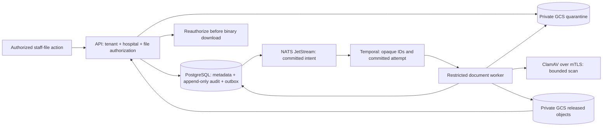

# Helivanta private document processing

Owner: Helivanta. Scope: private staff documents, story #1105.



1. Check the approved account/project/context before operational changes.
   Inspect worker/scanner readiness, definition age, CNPG and Temporal health,
   and the exact Argo/Kargo artifact. Read logs without exporting filenames,
   bytes, credentials, tokens or staff/patient values.
2. Missing or stale definitions, scanner transport errors and invalid content
   or integrity must never make a document available. Restore dependencies
   before retrying. Do not edit database status, manually promote an object,
   or disable scanning.
3. For a persisted processing error, use the authorized retry API with the same
   intent and explicit committed retry attempt. A repeated intent remains
   idempotent; a new attempt is a deliberate state transition.
4. A database outage spanning all activity attempts can leave `scan_pending`
   with a terminal failed Temporal execution because no error receipt could
   be persisted. Restore the database and worker, then verify the exact four
   ownership IDs and attempt in the initial input, expected workflow type and
   task queue, and the file's current pending attempt. Capture the execution
   and change ticket. Obtain specific reset approval before running:

   ```sh
   temporal --address temporal-frontend.temporal-system.svc.cluster.local:7233 \
     --namespace helivanta-documents-prod workflow reset \
     --workflow-id "$DOCUMENT_WORKFLOW_ID" --run-id "$DOCUMENT_RUN_ID" \
     --type FirstWorkflowTask --reason "$APPROVED_CHANGE_REFERENCE"
   ```

   Reset replays the same committed intent through the idempotent processor.
   Terminal receipts do no new remote work; a superseded attempt cannot change
   the current file. Do not batch reset or invent workflow IDs. Verify state,
   audit/outbox receipt and authorized API result afterwards. The CLI options
   were checked locally; production reset acceptance has not been performed.
5. Revoke through the authorized API. Immutable retention and seven-day GCS
   soft deletion are not immediate erasure. Apply retention and destruction
   through a separately approved policy.

Delivery gates

- Apply and verify the approved bucket IAM correction, preserving workload
  create/get-only permissions and production/verification separation.
- Reconcile KSA and exact OpenBao reader, privately provision the dedicated
  credential and project the basic-auth secret before approved LOGIN activation.
  Verify actual role flags, membership and effective grants.
- Apply migration `0008` through the owning release hook after the role exists.
  Test forced RLS and column grants through CNPG forwarding with synthetic scope
  IDs and the restricted credential.
- Prove actual GCS workload-identity access, including denied production access
  for the verifier and denied list/delete/overwrite operations.
- Promote the exact tested API artifact through Kargo. Enable documents after
  Temporal and current scanner definitions are ready. Test local and deployed
  UI/API upload, rejection, release, retry, download, revocation and cross-tenant
  and hospital denial.
- Verify alert evaluation and delivery. Prometheus is currently scaled to zero;
  prepared rules do not constitute operational alerting. Until automatic failure
  detection is proved, terminal failed executions require explicit recovery
  checks.

Rollback disables new uploads and restores the previous workload configuration
and image through GitOps. Preserve metadata, objects, role grants and history.
Do not reverse the additive migration or delete confidential data as a rollback.
